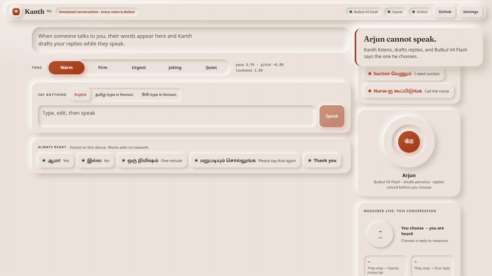
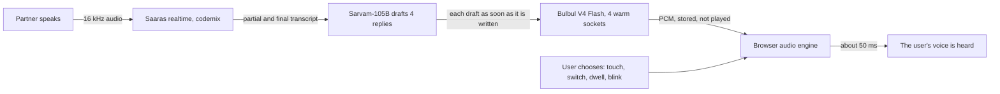
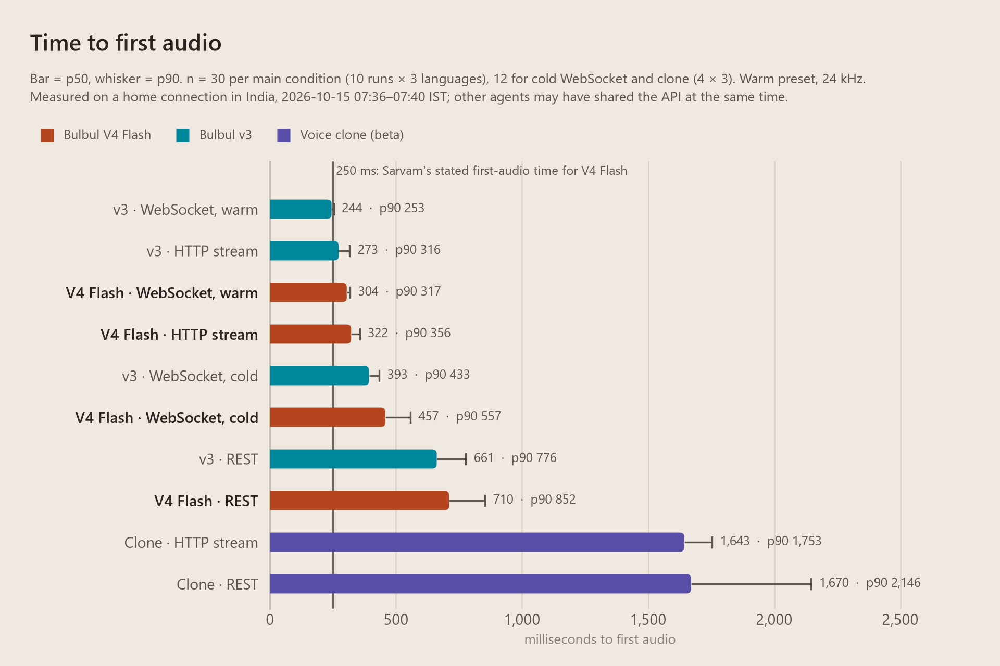
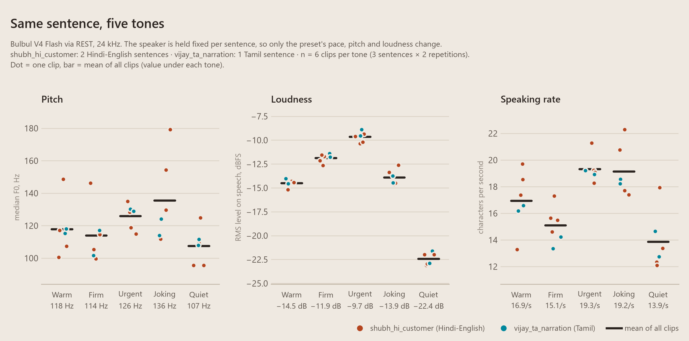
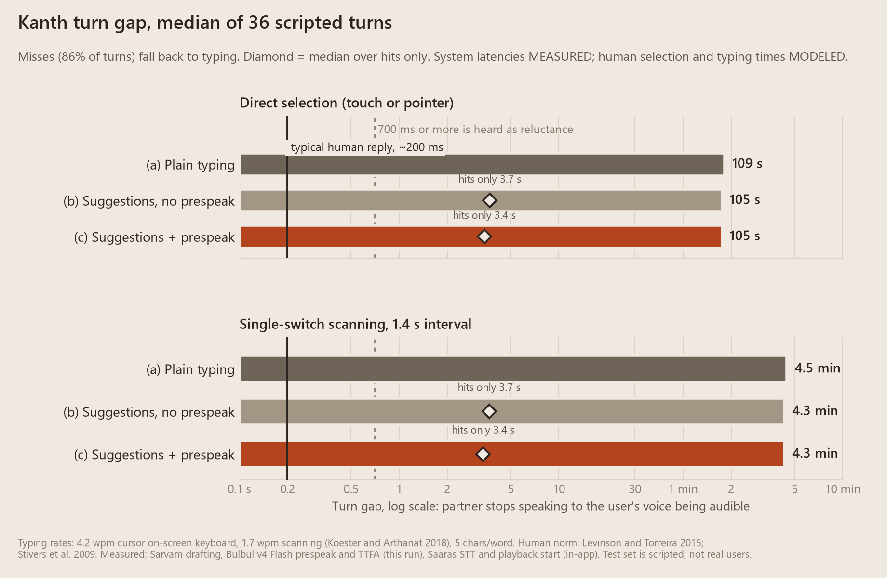

# Kanth

**A voice for people who cannot speak, in the languages they think in.** Built on Sarvam Bulbul V4 Flash.

In every other project Bulbul speaks *to* people. In Kanth, Bulbul speaks *as* someone.



**[Try it in your browser: kanth-nu.vercel.app](https://kanth-nu.vercel.app)** · [Watch the full demo with sound (MP4)](docs/media/kanth-demo.mp4) · [Architecture](docs/ARCHITECTURE.md) · [Why this idea](IDEAS.md) · [Decisions](DECISIONS.md)

## The problem, in numbers

When you cannot speak, every answer arrives late.

- Everyday conversation runs at **160 to 200 words per minute** (Switchboard corpus: 164 turn by turn, 196 overall). [1]
- People who talk through AAC (augmentative and alternative communication) devices typically manage **under 10 words per minute**. On-screen keyboards driven by eye gaze or a head pointer average **4.2**, and switch scanning averages **1.7**. [2][3]
- Across languages, the usual gap before a reply is **0 to 200 ms**, and gaps of **700 ms or more are heard as reluctance**. [4][5]
- So a ten word reply takes over two minutes by eye gaze and six minutes by switch. The conversation has moved on.
- India's Census 2011 counted **19,98,692 people with a speech disability**. Not all of them need AAC, but the tools they get today are mostly English, recorded phrase banks, or robotic voices. [6][7]

## What Kanth does

1. **Listens.** The person in front of you speaks Tamil, Hindi, English, or a mix. Saaras transcribes them live.
2. **Drafts while they talk.** Four short replies, in your language and the way you mix it ("ரசம் smell நல்லா வருது Amma"), drafted by Sarvam-105B from the words heard so far.
3. **Prespeaks.** Bulbul V4 Flash voices all four on warm connections before you choose. Nothing plays.
4. **You choose. It speaks.** Touch, one switch, two switches, dwell, or a deliberate blink. The chosen reply is heard about 50 ms after you choose it.

And around that loop:

- **Tone dial.** Warm, Firm, Urgent, Joking, Quiet. Each tone changes the words drafted and Bulbul's pace, pitch and loudness.
- **None of the four right?** One press on Yes, No, Not now, or a number from 0 to 10 redrafts all four around it, so a switch user can steer without typing. Or type a word or two, or anything at all in Roman letters; Kanth converts it to Tamil or Hindi script so Bulbul pronounces it properly.
- **Always ready, even offline.** "It hurts", "I need suction", "Call the nurse" are stored on the device in your voice and play with no network.
- **Your own voice, optional.** Bank 10 to 15 seconds of speech with Sarvam voice cloning, after an explicit consent step.

## Run it in about a minute

You need Node 20.19 or later and a Sarvam API key.

```bash
git clone https://github.com/Anandb71/kanth && cd kanth && npm install && SARVAM_API_KEY=sk_your_key npm start
```

On Windows PowerShell, put the key in a file instead: copy `.env.example` to `.env`, add the key, then run `npm install` and `npm start`.

Open http://localhost:5173 and press **Hear a conversation**. No microphone or login is needed. On our machine a fresh clone, install, build and start took 34 seconds with a warm npm cache ([bench/results/setup-time.md](bench/results/setup-time.md)); a cold cache downloads about 70 packages.

The key is read only by the server. It never reaches the browser or the repository.

## Try it online

**https://kanth-nu.vercel.app**: press **Hear a conversation**, then choose Arjun's replies. No install, key or microphone needed. Or press **Talk with your microphone**, then **Listen with microphone**, and speak to it in Tamil, Hindi, English or a mix.

The hosted version runs on Vercel functions, which cannot hold the long-lived WebSocket the local server uses, so it carries the same messages over short streaming HTTP requests ([web/src/lib/http-transport.ts](web/src/lib/http-transport.ts), [server/hosted.ts](server/hosted.ts)):

- **Drafting while they talk works here too.** While someone speaks, the browser sends the audio so far to Saaras about every 0.7 s, so partial transcripts arrive and the four replies are drafted and voiced before the line ends. For the microphone, the browser detects where each turn ends (an adaptive energy detector, [web/src/lib/vad.ts](web/src/lib/vad.ts), 1 s of quiet), and it ignores the microphone while Kanth is speaking, so it never transcribes its own voice.
- **Measured on the live site** (6 partner turns, [bench/results/live-hosted.json](bench/results/live-hosted.json)): Saaras transcript a median 336 ms after the line ended, first reply on screen at 710 ms (202 ms *before* the line ended at best), all four voiced at 1.6 s, 2 of 6 turns drafted while the partner was still speaking, and **the chosen reply heard 50 ms after the choice**, the same as locally. Reproduce: `cd film && KANTH_URL=https://kanth-nu.vercel.app OUT=live-hosted.json npx tsx live-app.ts 2`.
- **Instant start.** The partner's three lines and the default emergency phrases ship as audio pre-generated with Bulbul ([scripts/make-static-audio.ts](scripts/make-static-audio.ts)), so the demo starts at once and the phrase board works offline on a first visit. Everything Arjun says is still drafted and voiced live.
- **It does not die if Sarvam does.** If the live service cannot be reached, the demo replays a recorded real run of the same conversation and says so on screen ([web/src/lib/replay-transport.ts](web/src/lib/replay-transport.ts), recorded with [film/record-replay.ts](film/record-replay.ts)).
- **Guarded.** The public demo uses a shared key: requests must come from Kanth's own page, each visitor is rate limited, and text and audio sizes are capped. Voice banking runs only in the local version.

**Tested end to end** with [film/e2e.ts](film/e2e.ts) in a real browser: page load and links, the full demo, steering and tone, single-switch scanning, the offline board, the recorded-run fallback with every API call blocked, phone layout, and the microphone (fed a Bulbul-generated clip). 8 of 8 checks pass on the live site. Run it yourself: `cd film && KANTH_URL=https://kanth-nu.vercel.app npx tsx e2e.ts`.

Deploy your own: `node scripts/build-vercel.mjs && vercel deploy --prebuilt --prod`, with `SARVAM_API_KEY` set as a Vercel environment variable.

## How it works



The server holds the Sarvam key and the warm connections; the browser holds the conversation and decides what is spoken. Details, message types and failure handling: [docs/ARCHITECTURE.md](docs/ARCHITECTURE.md).

## Why Bulbul V4 Flash is the hero

Every word the user says is Bulbul. The language model only proposes; the user only chooses; Bulbul is the voice.

- **Tone you can hear.** Pace, pitch and loudness are V4 Flash controls (v3 offers pace only). Urgent is 4.8 dB louder than Warm; Quiet is 7.9 dB softer and 18% slower. Measured below.
- **Speed inside the turn.** Four replies voiced in parallel on four warm sockets, often ready the moment the other person stops. Queued on one socket, the same four take 1.7 s. [8]
- **Code-mixed Indian speech.** Native script for Indian words, Latin for English words, as Sarvam recommends, with Saaras `codemix` transcripts feeding the drafts and `enhi` personas for Hinglish.
- **No dead air at the moment of choice.** Prespeak turns time to first audio into time to first frame.

## Measured

Every number here comes from a script in [bench](bench) or [film](film), with raw data in [bench/results](bench/results). Measured on a home connection in India on 2026-10-15.

### In the live app

Nine partner turns across three runs of the demo, with Saaras, drafting and Bulbul all live ([bench/results/live-app.json](bench/results/live-app.json)). Reproduce: `cd film && npx tsx live-app.ts 3`.

| From the moment the partner stops | Median | Range |
|---|---|---|
| Saaras final transcript | 287 ms | 206 to 348 ms |
| First reply on screen | 16 ms | 658 ms *before* they stop to 422 ms after |
| All four replies on screen | 95 ms | 657 ms before to 561 ms after |
| All four voiced and ready | 815 ms | 29 ms before to 1.12 s after |
| **The user chooses, and is heard** | **51 ms** | 50 to 58 ms (prespoken, including the browser's output latency) |

Negative times come from drafting while they talk. Typed text that was not prespoken is heard about 400 ms after pressing Speak.

### Time to first audio, Bulbul



| Condition (n = 30, three languages) | p50 | p90 |
|---|---|---|
| V4 Flash, warm WebSocket | 304 ms | 317 ms |
| V4 Flash, HTTP stream | 322 ms | 356 ms |
| V4 Flash, REST | 710 ms | 852 ms |
| v3, warm WebSocket | 244 ms | 253 ms |
| v3, HTTP stream | 273 ms | 316 ms |
| Cloned voice, HTTP stream (n = 12) | 1,643 ms | 1,753 ms |

From our connection, V4 Flash did not reach Sarvam's "under 250 ms" figure, and v3 was 30 to 60 ms faster. We report it as measured. Kanth hides this cost with prespeak, and chose V4 Flash for its pitch and loudness controls, persona styles and lower price ([DECISIONS.md](DECISIONS.md), item 16). Details: [bench/results/ttfa.md](bench/results/ttfa.md). Reproduce: `npm run bench:ttfa` (about 230 calls, a few rupees).

### Tone proof



Same sentences, same speaker, five tones, 30 clips. Relative to Warm on the same sentence:

| Tone | Pitch | Loudness | Speaking rate |
|---|---|---|---|
| Firm | -0.7 semitones | +2.6 dB | -11% |
| Urgent | +1.2 semitones | +4.8 dB | +14% |
| Joking | +2.2 semitones | +0.6 dB | +13% |
| Quiet | -1.7 semitones | -7.9 dB | -18% |

Loudness separates the tones cleanly. Pitch and rate move the right way but overlap, partly because Bulbul's output varies between identical requests. Details: [bench/results/tone.md](bench/results/tone.md). Reproduce: `npm run bench:tone`, then `python bench/tone_analyze.py` (needs numpy, scipy, soundfile and praat-parselmouth).

### Conversations: does it say what the user means?

We wrote short scripted conversations (home, clinic, friends, caregivers) in Tamil, Hindi and English, and for each turn wrote down what the user actually wanted to say, before seeing any model output. A Sarvam-105B judge, run twice, decided whether any of the four drafts said the same thing; a hit counts only when both runs agree. These are scripted test sets written by us, not real users.

| Set | Turns | A draft said it | Said after one steering step | Said without typing |
|---|---|---|---|---|
| First run, original prompt | 36 | 5 (14%) | not tried | 5 (14%) |
| **Held-out set, written blind after the fixes** | **24** | **3 (12%)** | **+3** | **6 (25%)** |
| Original set, after the fixes (optimistic: it motivated them) | 36 | 3 (8%) | +9 | 12 (33%) |

What this means, plainly:

- **Most turns still need typing.** The intended replies are specific ("Not Thursday, come Friday", "Only riluzole, no new medicines"), and no model can guess that. Steering with one or two words doubles how often the user is heard without typing.
- **Motor actions barely fall overall:** 1 to 2% fewer on the held-out set and 7 to 8% fewer on the original set, because a miss costs the steering attempt plus the typing. Tamil did worst (no direct hits on either set after the fix).
- **When a draft fits, the turn is transformed.** Modeled from measured system times and cited human rates, a hit takes about 3.4 s from the partner stopping to the user being heard, against about 109 s to type the same reply by eye gaze and 4.5 minutes with one switch.



The first prompt had two bugs this benchmark caught: format examples that addressed "Amma" taught the model to call everyone Amma, and profile notes leaked into unrelated replies. Both are fixed, with tests. Details: [bench/results/conversations-v2.md](bench/results/conversations-v2.md) (v2 summary) and [bench/results/conversations.md](bench/results/conversations.md) (v1 method, turn gap model and every draft). Reproduce: `npm run bench:conversations`, then `python bench/conversations_v2_summary.py`.

### Cost

Prices from Sarvam's pricing page and the V4 Flash launch post, read on 2026-10-15. Bulbul characters are almost all of the cost.

| Scenario | ₹ per minute | ₹ per hour |
|---|---|---|
| Busiest case, every turn a hit, with prespeak | 1.86 | 111 |
| Busiest case, without prespeak | 0.70 | 42 |
| Our test set as measured (most turns typed), with prespeak | 0.24 | 14 |

Prespeak synthesizes about four times the characters actually spoken. Drafting while they talk can add up to three more drafts per turn and is not included above; switch it off in Settings to stay within these figures. Details and every input: [bench/results/cost.md](bench/results/cost.md). Reproduce: `npm run bench:analyze`.

## Accessible to the people it is for

- Huge targets, every one reachable by keyboard, with screen reader labels and live announcements.
- One switch scanning that jumps straight into the replies when they arrive, and pauses after three silent loops to avoid fatigue. Two switch scanning. Dwell with a visible fill bar, for head pointers and eye trackers. Blink as a switch, using MediaPipe on the device; the video never leaves it.
- Adjustable scan speed, dwell time, blink length and text size. Light, dark and a flat high contrast theme.
- Every failure is shown in plain words with what Kanth did about it. If Bulbul cannot be reached, the device voice speaks rather than leaving the user silent.

## Ethics

- **Nothing is ever spoken that the user did not choose.** Drafts are proposals. Prespoken audio is stored, never played, until the user picks it.
- **Simulated, and labelled.** Arjun is a fictional user. Every voice in the demo and film is generated by Bulbul. The conversations in the benchmark are scripted test data written by us, not real users, and the intended replies were written before any model output was seen.
- **Consent before cloning.** Banking a voice requires the speaker's name and two explicit confirmations, and the recording script doubles as a spoken consent statement. The demo voice is cloned from a clip Bulbul itself generated, so no real person's voice is involved.
- **What leaves the device.** Speech, drafts and text go to Sarvam's APIs to be processed. Kanth stores nothing on its server. Settings, profile and offline phrases stay in the browser.
- **Not a medical device.** Kanth has not been tested with AAC users. Before anyone relies on it, it needs testing with people who use AAC every day, their families and speech therapists.

## Hard questions

**Isn't the language model the hero, not Bulbul?** The model proposes words; nobody hears them until Bulbul says them. What the person on the other side experiences is the voice: its language, its code-mixing, its tone and its timing. Every one of those is Bulbul.

**You prespeak, so why does Flash matter?** Because the four replies have to be voiced inside the other person's turn. Kanth starts drafting and voicing from the partial transcript, and Flash on four warm sockets finishes all four in about half a second. That is what makes the reply instant at the moment of choice.

**v3 was faster to first audio in your own test. Why V4 Flash?** The tone dial needs pitch and loudness, which v3 does not offer; persona styles give each tone a different delivery; V4 Flash costs less per character; and with prespeak the user never waits for first audio anyway.

**What if none of the four replies is right?** Often none is: see the conversation benchmark above. Typing one or two words redrafts all four around them, and free typing is always there. Kanth only ever adds a faster path; it never takes one away.

**Whose words are these?** The user's, because nothing is said until they choose it, and they can steer or type instead. The drafts are told never to invent facts, appointments or symptoms.

## Prior art and credits

Listening to the partner and suggesting replies is not new. Converser (Wisenburn and Higginbotham, 2008) predicted replies from the partner's speech; Lingraphica Conversations, Voixa and Google's SpeakFaster use language models for AAC today. [9][10] Scanning AAC devices already speak options quietly to the user as they scan (auditory preview). What we found no prior art for is synthesizing every option in the user's outward voice before the choice, so the chosen one plays instantly, in natural code-mixed Indian speech, operable with one switch. Our full search is in [research/evidence.md](research/evidence.md).

Built with Sarvam Bulbul V4 Flash, Saaras, Sarvam-105B, transliteration and voice cloning. Fonts: Noto Sans for every script, Fraunces, JetBrains Mono.

## Sources

1. Yuan, Liberman and Cieri, "Towards an integrated understanding of speaking rate in conversation", Interspeech 2006. https://www.ldc.upenn.edu/sites/default/files/interspeech2006-towards-integrated-understanding.pdf
2. Koester and Arthanat, "Text entry rate of access interfaces used by people with physical disabilities: a systematic review", Assistive Technology 30(3), 2018. PMID 28368689.
3. Trnka et al., "The effects of word prediction on communication rate for AAC", NAACL 2007. https://aclanthology.org/N07-2044.pdf
4. Stivers et al., "Universals and cultural variation in turn-taking in conversation", PNAS 106(26), 2009.
5. Levinson and Torreira, "Timing in turn-taking and its implications for processing models of language", Frontiers in Psychology 6:731, 2015. https://pmc.ncbi.nlm.nih.gov/articles/PMC4464110
6. MoSPI, "Disabled Persons in India: A Statistical Profile 2016", Table 5 (Census 2011). https://mospi.gov.in/sites/default/files/publication_reports/Disabled_persons_in_India_2016.pdf
7. Ace Centre listing for Avaz India, and other Indian AAC tools: see [research/evidence.md](research/evidence.md), sections A5 and A9.
8. Measured with live probes; see [research/sarvam-api.md](research/sarvam-api.md).
9. Wisenburn and Higginbotham, "An AAC application using speaking partner speech recognition to automatically produce contextually relevant utterances", AAC 24(2), 2008. PMID 18465364.
10. Cai et al., "Using large language models to accelerate communication for eye gaze typing users with ALS", Nature Communications 15:9449, 2024.

## License

MIT
