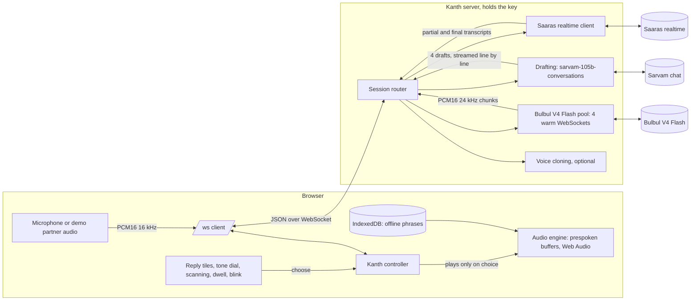

# Architecture

Kanth is one Node server and one browser client. The server holds the Sarvam key and keeps warm connections to Sarvam. The browser holds the conversation, the audio, and every decision about what is spoken.

## Hosted mode (Vercel)

The same client also runs against one combined streaming HTTP function ([server/hosted.ts](../server/hosted.ts), bundled by [scripts/build-vercel.mjs](../scripts/build-vercel.mjs)) through [web/src/lib/http-transport.ts](../web/src/lib/http-transport.ts), because serverless functions cannot hold a WebSocket. One function serves every endpoint, so one warm instance answers them all. Synthesis and drafting stream over HTTP and prespeak is driven from the browser. Speech recognition re-sends the audio so far about every 0.7 s for rolling partial transcripts, so drafting can start while they talk, then sends the whole line when it ends; the live microphone finds each turn's end in the browser ([web/src/lib/vad.ts](../web/src/lib/vad.ts)).

- **Static audio.** The partner's demo lines and the default emergency phrases ship as audio pre-generated with Bulbul ([scripts/make-static-audio.ts](../scripts/make-static-audio.ts)), so the demo starts at once and the board works offline on a first visit. Every reply the user can choose is still drafted and voiced live.
- **Recorded-run fallback.** If Sarvam cannot be reached, the demo replays a recorded real run of the same conversation and says so ([web/src/lib/replay-transport.ts](../web/src/lib/replay-transport.ts), recorded with [film/record-replay.ts](../film/record-replay.ts)).
- **Guards.** The function checks the request comes from Kanth's own page, caps text and audio sizes, and rate limits each visitor. The rate limit counts are held in memory per function instance, so they reset on a cold start and are not shared between instances.

Build and deploy with `node scripts/build-vercel.mjs && vercel deploy --prebuilt --prod`.

## One turn, step by step

1. **Listen.** Partner audio streams to the server in 100 ms frames of 16 kHz PCM16, and on to Saaras realtime (`mode=codemix`). Partial transcripts appear live in the display.
2. **Draft while they talk.** From three heard words onward, the client asks for drafts from the partial transcript, and again as the sentence grows (at most three times). The server streams `sarvam-105b-conversations` output and parses each line the moment it completes.
3. **Check, then prespeak.** Each draft is checked first: one in the wrong script, a near-duplicate, one that states a number when the partner asked for one and the user has not given it, or one that names the wrong person is dropped. Each remaining draft goes to a free socket in the Bulbul pool as soon as it is parsed: config, text, flush. PCM chunks flow back to the browser, which stores them. Nothing plays.
4. **Partner stops.** Saaras returns the final transcript. If it adds little to what the drafts were based on, the drafts stand. Otherwise Kanth drafts again.
5. **Choose.** Touch, a switch, dwell or a blink selects a tile. The audio engine starts the already decoded buffer on the next audio frame.
6. **Never silent.** If a reply was not prespoken, it is synthesized on choice and played as it streams. If Bulbul cannot be reached, the device voice speaks it and a notice says so.

## Measured latency path (local server, 9 partner turns)

From [bench/results/live-app.json](../bench/results/live-app.json), recorded by `film/live-app.ts` against `npm start`. Negative means before the partner finished. On the hosted site all four were voiced a median 1.6 s after the partner stopped ([bench/results/live-hosted.json](../bench/results/live-hosted.json)). The choice-to-voice time is nearly all the browser's reported output latency; it was not measured acoustically.

| Step | Median | Range |
|---|---|---|
| Partner stops to Saaras final transcript (manual endpointing) | 287 ms | 206 to 348 ms |
| Partner stops to first draft shown | 16 ms | -658 to 422 ms |
| Partner stops to all four drafts shown | 95 ms | -657 to 561 ms |
| Partner stops to all four voiced | 815 ms | -29 to 1,120 ms |
| Choice to the voice being heard (prespoken) | 51 ms | 50 to 58 ms |
| Typed text to the voice being heard (not prespoken) | about 400 ms | 3 turns, read by hand in the app |

Full benchmarks with raw data are in [bench/results](../bench/results).

## Messages

Defined in [shared/protocol.ts](../shared/protocol.ts). The browser sends `synth`, `suggest` (with optional `keywords`), `stt_start`, `stt_audio`, `stt_stop`, `translit`, `cancel` and `ping`. The server sends `audio` chunks, `audio_end` (with time to first audio, transport, model and speaker), `suggestion`, `suggestions_done`, `transcript`, `status` and `error`. Every error carries the fallback Kanth applied, in plain words, which the UI shows.

## Failure handling

| Failure | What Kanth does |
|---|---|
| A Bulbul socket drops or stalls (no audio in 5 s) | Reconnect with exponential backoff and jitter; meanwhile synthesize over HTTP streaming, then REST |
| Bulbul unreachable at choice time | Speak with the device voice if it has the language; else speak the English meaning; else show the reply full screen for the partner to read. Always say which |
| A held or repeated switch press | Ignored: key repeat is dropped and every selection starts a short lockout |
| Replies change while the user is choosing | Redrafts swap in all at once, scanning restarts on the first reply, and choices within 500 ms of a change are refused |
| A request from another website | Refused: WebSocket and API calls must come from Kanth's own page |
| Bulbul returns runaway audio | Cut at 3 s plus 0.3 s per character |
| A draft states a number nobody gave, or names the wrong person | Dropped before it is shown or voiced; spare drafts fill its place |
| The user cancels a reply before its audio arrives | It is never spoken, by Bulbul or by the device voice |
| Drafting fails | Notice; the phrase board and free typing remain |
| Saaras gives no final transcript in time (demo) | Use the scripted line and say so |
| Browser loses the network | Link shows Offline at once; cached phrases still speak; reconnect on `online` |
| No API key | The server still starts and the UI explains how to add one |

## Files

| Path | What it is |
|---|---|
| [server/bulbul.ts](../server/bulbul.ts) | Warm socket pool, HTTP streaming and REST transports, fallback |
| [server/suggest.ts](../server/suggest.ts) | Drafting prompt, streaming parser, script guards |
| [server/stt.ts](../server/stt.ts) | Saaras realtime client |
| [server/session.ts](../server/session.ts) | Per-browser router, prespeak, audio guard |
| [server/clone.ts](../server/clone.ts) | Voice cloning (optional) |
| [server/translit.ts](../server/translit.ts) | Roman to native script |
| [shared/voices.ts](../shared/voices.ts) | Language and speaker routing, including bulbul:v3 for Malayalam and Odia |
| [shared/tones.ts](../shared/tones.ts) | Tone presets |
| [web/src/lib/kanth.ts](../web/src/lib/kanth.ts) | Conversation state, drafting while they talk, choosing, metrics |
| [web/src/lib/audio.ts](../web/src/lib/audio.ts) | Prespoken buffers, gapless streaming playback, live audio levels |
| [web/src/lib/access.ts](../web/src/lib/access.ts) | Switch scanning and dwell |
| [web/src/lib/blink.ts](../web/src/lib/blink.ts) | Blink switch with MediaPipe |
| [web/src/lib/demo.ts](../web/src/lib/demo.ts), [film.ts](../web/src/lib/film.ts) | Interactive demo and the recorded film |
| [tests](../tests) | Unit tests for routing, parsing, prompts, PCM handling and transliteration helpers |
| [bench](../bench) | Benchmarks; every number in the README comes from here |
